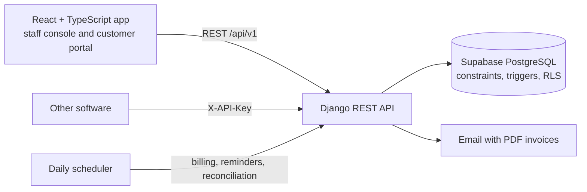

# Brightloop: Subscription Management System

**Hackathon submission · v1.1.0 · 31 Oct 2026**

## The problem
Brightloop Software sells everything on subscription, but runs it on spreadsheets and memory: subscriptions live in a
sheet, renewals are missed, invoices are typed by hand and go out wrong, payments are matched by scrolling bank
statements, and nobody can say how much recurring revenue the company has.

## The solution
One platform that runs the whole subscription business, from the first quote to the last rupee collected:

| Brief scene | What Brightloop does |
|---|---|
| A new customer signs up | Sign-up with a strong-password rule enforced on the server, one account per email, reset link by email, roles (Admin, Staff, Customer), only the admin adds staff, customers see only their own data |
| Launching a new plan | Products with variants and price extras (Odoo brand +560); plans with daily/weekly/monthly/yearly billing, minimum quantity, availability dates and close / pause / renew rules |
| Turning a quote into a subscription | Quotation templates valid for N days; numbered subscriptions moving Draft → Quotation → Confirmed → Active → Closed with a visible timeline |
| Billing day | Invoices generated automatically, never twice (unique subscription + period), catch-up for missed days, dry-run preview, GST split by place of supply (CGST+SGST / IGST), confirm, cancel, send, print and **PDF** |
| A customer asks for a better price | Admin-only discounts: fixed or %, minimums, dates, usage limits, product or subscription scope, applied automatically until they expire or run out |
| The money comes in | Payments with method, amount, date and note; partial payments; paid, outstanding and overdue always visible |
| The finance lead | Live dashboard: active subscriptions, MRR, ARPU, churn, billed vs collected, overdue, 30/60/90-day forecast, at-risk customers, filters; every page under 2 s at 10,000 subscriptions |

## Beyond the brief
- **Invoice PDFs** (GST tax invoice) downloadable by staff and customers and attached to every invoice email.
- **Renewal reminders** 30, 7 and 1 day before expiry, each sent once, shown on the timeline.
- **Free trials**: a 0 trial plan started on sign-up or with one click, one per customer, closes itself, converts to a
  paid plan that starts the day the trial ends.
- **Money you can trust**: the database itself rejects impossible amounts, issued invoices and payments cannot be
  edited, and a nightly reconciliation re-adds every total and emails admins on any mismatch.
- **Audit log**: every sensitive action with who, how (web, API key, system) and from where; append-only.
- **Public API** with hashed, scoped, revocable keys, idempotent retries and rate limits; **Swagger and ReDoc** docs.
- **Customer portal**: own subscriptions and invoices, accept quotes, pause, renew, start a trial, download PDFs.

## Architecture

React + TypeScript + Vite · Django 5 + DRF · Supabase PostgreSQL (session pooler) · xhtml2pdf · GitHub Actions.
Decisions: `docs/adr/0001-time-boxed-mvp.md` and the README.

## Run it
```powershell
python scripts/dev.py setup
python scripts/dev.py migrate
python scripts/dev.py seed --reset
python scripts/dev.py up        # app http://localhost:5173 · API docs http://127.0.0.1:8000/api/docs
```
Logins: `admin@brightloop.test`, `staff@brightloop.test`, `customer@brightloop.test` (password in `DEMO_PASSWORD`, or
the seed default). A 7-minute walkthrough is in `docs/runbooks/demo.md`.

## Evidence
- **76 automated tests** on real Postgres (69 on SQLite), including a golden billing example, concurrency tests
  (parallel billing runs, discount limits, gap-free numbering), authorization negative tests and trial / reminder /
  PDF flows.
- **CI** on every push: lint, both test suites, API schema validation, frontend build, gitleaks secret scan.
- **Scale**: 10,000 subscriptions, 75,000 invoices; every endpoint p95 under 1.6 s against Supabase.

## What's next
Invoice branding and number formats, payment reminders (dunning), promo codes, online payments (Razorpay), an AI
finance assistant, and multi-company workspaces.
